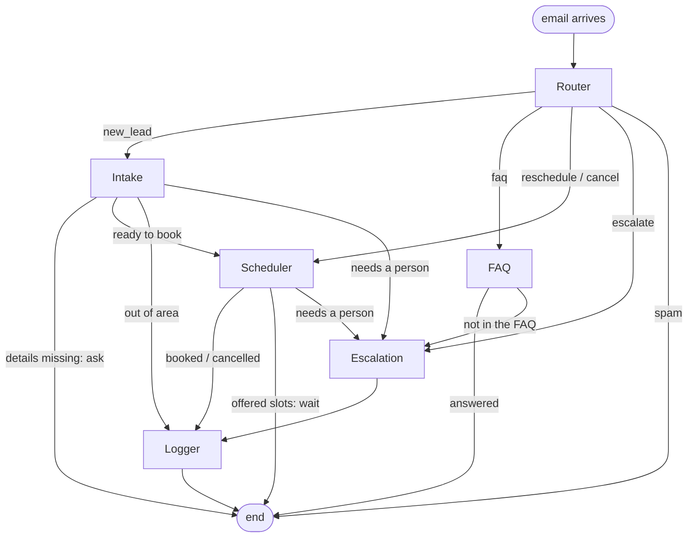

# Rebbecca: an AI customer service agent for small HVAC businesses

Rebbeecca is the customer service lady your HVAC business doesn't have time to hire. She watches the company inbox, answers customers within seconds, collects the job details, books an appointment, logs every lead to Google Sheets, and hands the conversation to a person whenever she shouldn't be the one answering.

She is the email version of a "missed-call follow-up" product: the customer reaches out, nobody is free to answer, and Rebbeecca makes sure they are not lost.

**Built with LangGraph, Groq and Gemini (free tiers), Gmail and Google Sheets. Total cost to build and run: $0.**

| | |
|---|---|
| **17 / 17** | multi-email scenarios passed in every run (51 of 51 runs) on the real models |
| **1.2 s** | average time per email (slowest 3.5 s) |
| **$0.0003** | cost per conversation at paid-tier rates (the free tier makes the real cost $0) |
| **267** | offline tests, no network needed |

---

## What it does

A customer emails: *"My AC stopped working, can someone come tomorrow afternoon?"*

1. **Replies in the same thread** within seconds.
2. **Collects the missing details** over one or more emails: name, address, issue, urgency, preferred day.
3. **Offers real appointment slots** near the day they asked for, and **books** the one they pick.
4. **Logs the lead and the booking** to Google Sheets (CSV fallback), one row per conversation.
5. **Escalates to the owner** when it should not answer: a question the business has not written an answer to, a complaint, a safety emergency. The owner gets the full transcript, and the agent stops auto-replying on that thread.

### Example conversation (illustrative, synthetic data)

```
CUSTOMER  Hi, my AC stopped working. Can someone come out tomorrow afternoon?
REBEECCA  Sorry to hear that. I can help get you booked. What's your name and the address of the property?
CUSTOMER  Sam Rivera, 12 Oak Street, Westfield.
REBEECCA  Thanks Sam. I have tomorrow at 1:00 PM, 2:00 PM or 3:00 PM available. Which works best?
CUSTOMER  2 please
REBEECCA  You're booked for tomorrow at 2:00 PM at 12 Oak Street. A technician will see you then.
```

---

## Why it is built this way

This project is a study in **controlled agent orchestration**: let the LLM do what it is good at (reading messy human email), and let code do everything that must be right.

### Architecture

Six nodes in a LangGraph graph, sharing one typed state:



| Node | Job |
|---|---|
| **Router** | Emergency check in code first, then handoff check, then LLM classification into `new_lead`, `faq`, `reschedule`, `cancel`, `escalate`, `spam` |
| **Intake** | Extracts name, address, issue, urgency and preferred day across several emails |
| **FAQ** | Answers only from the client's YAML. Anything not stated there goes to a person |
| **Scheduler** | Offers slots, books on confirmation, reschedules, two-step cancel |
| **Logger** | Writes the lead and booking to Google Sheets (CSV fallback) |
| **Escalation** | Emails the owner a transcript, replies to the customer, marks the thread handed off |

### Guardrails enforced in code, not only in prompts

- **No double-booking.** `book_slot()` re-checks availability, business hours and lead time immediately before writing. The LLM never decides availability.
- **No invented facts.** FAQ answers come only from the client's YAML. "Do you offer X?" for anything not listed escalates instead of guessing.
- **Safety first.** Gas, carbon monoxide, smoke and fire are detected in code with fuzzy phrase matching and answered with a "call 911" reply immediately, even in a conversation already handed to a person.
- **Dates are validated by code.** The LLM returns a structured date; code checks it is not in the past, at most 60 days ahead, and inside business hours.
- **Cancellation needs an explicit YES,** read by code, never by the LLM.
- **Human handoff is final.** After an escalation the agent goes quiet on that thread.

### Production habits

- **Two LLM providers with automatic failover.** One primary and one backup (Groq and Gemini), chosen by `LLM_PRIMARY`. Failover triggers only on provider failures (rate limit, timeout, server error, malformed output) and never on bugs in our own code, so bugs are not hidden.
- **Own 20 second deadline per LLM call,** enforced in code.
- **Persistent memory.** Conversation state is checkpointed to SQLite per Gmail thread, so a restart continues every conversation.
- **Safe for an open inbox.** Loop guard (never replies to no-reply addresses, auto-replies, mailing lists or itself), 10 emails per sender per hour and 200 per day, Reply-To only honoured on the sender's own domain, optional sender allow-list.
- **Label first, then process.** A crash may miss a reply but never sends two.
- **One copy only.** An OS-level file lock stops two instances answering the same email.
- **Failures never block the customer.** If Sheets or the owner notice fails, the error is recorded and the reply still goes out.
- **Per-client behaviour comes from one YAML file** (business name, tone, hours, services, FAQs, pricing, escalation email, emergency phrases, timezone), validated at startup. A second client needs a new file, not new code.

---

## Results

17 multi-email scenarios, each run 3 times on the real models (`python -m evals.run`):

| Primary model | Pass rate | Seconds per email (avg / slowest) | Cost per conversation (paid-tier rates) | Primary calls that failed over |
|---|---|---|---|---|
| **Groq** (current) | 51 / 51 (100%) | 1.2 / 3.5 | $0.00033 | 0 of 126 |
| Gemini | 51 / 51 (100%) | 6.2 / 18.7 | $0.00032 | 50 of 126 (mostly 503 "high demand") |

Scenarios cover booking, preferred day, same-day requests, a slot taken between offer and pick, FAQs, an unknown question, a mid-conversation topic switch, a gas emergency, a complaint, spam, out-of-area customers, cancel (yes and no) and reschedule.

**The Gemini row is the interesting one.** Both models scored 100%, but 40% of Gemini calls had failed and been rescued by the backup. A pass rate measures outcomes, not reliability. That finding led to the Groq primary and the code-enforced deadline.

---

## What broke and how I fixed it

Every bug found in testing was written up. A few of the best:

- **A 100% pass rate hid a 40% failure rate, and one call hung for 8 minutes.** With Gemini as primary every eval passed, but 50 of 126 calls had failed over, and one hung 486 seconds despite a 15 second library timeout. Fix: my own deadline around every call, and failover metrics in the eval report.
- **A state bug only a multi-email test could find.** An old reply could be sent again on the next email because per-run fields persisted in the checkpoint. Fix: the router resets per-run fields each run.
- **The safety check missed natural phrasing.** "I smell gas" and "the gas is leaking" slipped past a plain substring match. Fix: fuzzy phrase matching with word endings and a small word gap.
- **Two copies of the agent ran against one inbox.** Fix: an OS file lock that is released automatically even on a crash.
- **I configured a service account as the agent's inbox.** A service account is a robot identity with no mailbox. Fix: an OAuth desktop client for Gmail, the service account for Sheets.

---

## What is real and what is stubbed

| Part | Status |
|---|---|
| Gmail reading, replying, labels | Real, tested live against a dedicated demo inbox |
| Google Sheets logging | Real (service account), with CSV fallback |
| LLM calls (Groq, Gemini) | Real, free tiers |
| **Calendar** | **Local JSON file behind an interface.** Google Calendar is a planned swap |
| Customer data | **Synthetic only** |

Known gaps are tracked honestly in [`docs/KNOWN_ISSUES.md`](docs/KNOWN_ISSUES.md). The most important: Gemini's free tier may use inputs to improve Google's products, so real customer data needs a paid tier or a local model first.

---

## Tech stack

- **Python 3.11+**, pinned versions in `requirements.txt`
- **LangGraph** for orchestration only (graph, state, routing, checkpointing)
- **LangChain** only for chat model wrappers and structured output
- **Pydantic** for config validation and LLM output schemas
- **Groq** and **Gemini** (free tiers) with automatic failover
- **Gmail API** (OAuth), **Google Sheets API** (service account), **SQLite** for conversation memory
- **pytest** for tests, plus a custom eval runner on the real models

---

## Run it

```bash
python -m venv venv
venv\Scripts\activate
pip install -r requirements.txt
```

Create a `.env` with your Groq and Gemini keys and `LLM_PRIMARY=groq`.

| Command | What it does |
|---|---|
| `python chat.py` | Play the customer in the terminal. No Gmail needed. **Start here.** |
| `python -m pytest -q` | Offline tests (no network) |
| `python -m evals.run --primary groq` | Evaluation on the real models |
| `python graph.py` | Print the graph as a Mermaid diagram |
| `python -m adapters.gmail` | One-time Gmail login (creates `token.json`) |
| `python main.py` | Dry run against the real inbox |
| `python main.py --live` | Really reply |

---

## Project layout

```
core/       config, llm (failover), state, messages, metrics, safety, dates, failures, ratelimit, single_instance
agents/     router, intake, faq, scheduler, logger, escalation
adapters/   gmail, email_rules, sheets, csv_log, calendar_json, console_mail
config/     clients/hvac_demo.yaml  (everything client-specific)
app.py      assembles config + adapters + nodes + graph
graph.py    the graph wiring and routing functions
main.py     the live Gmail loop
chat.py     terminal chat for trying it out
evals/      17 scenarios and a runner for the real models
tests/      offline tests with fake LLMs
docs/       business requirements, technical spec, known issues
```

`core/` contains no HVAC-specific code, so it can be lifted into a shared package for other agents.

Further reading: [`docs/BRD.md`](docs/BRD.md) (what and why), [`docs/TECH_SPEC.md`](docs/TECH_SPEC.md) (how it is built), [`docs/KNOWN_ISSUES.md`](docs/KNOWN_ISSUES.md).

---

## About this project

I built this as a portfolio project to learn agent orchestration end to end. **It was built with Claude Code assistance**: I designed the scope and guardrails, approved the structure before any code, ran and tested each piece, and can explain every node and edge. Claude Code wrote much of the implementation under that direction.

*Onious George*
