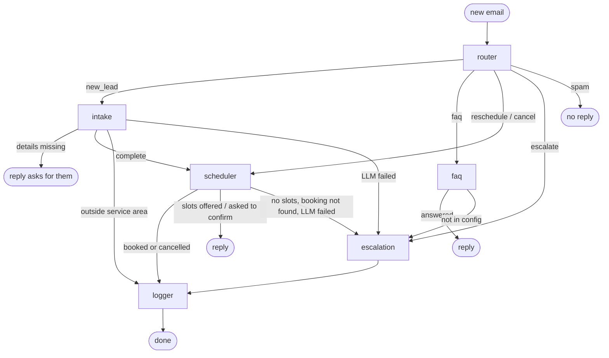

# Technical Specification
**Project:** HVAC Lead Intake & Booking Agent (Project 1)
**Version:** 0.2 (matches the code as of 2026-10-22) | **Companion:** `BRD.md` (requirement IDs like BR-4 refer to it)

## 1. Overview
An email-driven multi-agent workflow built with **LangGraph**. `main.py` polls a Gmail inbox, runs each new customer email through a graph (router, intake, FAQ, scheduler, logger, escalation), sends the reply in the customer's thread, and logs leads and bookings to Google Sheets. Business-specific behavior comes from one YAML file per client.

## 2. Technology stack
| Layer | Choice | Notes |
|---|---|---|
| Language | Python 3.11+ | Dev machine runs 3.13; every version pinned in `requirements.txt` |
| Orchestration | LangGraph | Graph, state, conditional routing, checkpointing |
| LLM wrappers | LangChain (`langchain-google-genai`, `langchain-groq`) | Model wrapper, structured output only |
| Models | Groq `openai/gpt-oss-120b` and Gemini `gemini-3.1-flash-lite` (free tiers) | `LLM_PRIMARY` picks which is primary; the other is the automatic backup |
| Schemas | Pydantic | Structured output and config validation |
| Email | Gmail API, OAuth desktop client | Scope `gmail.modify`; token in `token.json` |
| CRM | Google Sheets API, service account | Falls back to CSV files if Sheets is not configured |
| Calendar | Local JSON file | Same interface a Google Calendar adapter would have |
| Conversation memory | SQLite (`langgraph-checkpoint-sqlite`) | `data/conversations.sqlite`; survives restarts |
| Tests | pytest + an evaluation runner on real models | `tests/`, `evals/` |

## 3. Architecture



Generated from the code with `python graph.py`. Layers:
- **`adapters/`** isolate outside systems (Gmail, Sheets, calendar, CSV) behind small interfaces. Nodes never call Google directly.
- **`agents/`** are the graph nodes. Each reads the state, does one job, and returns only the fields it changes.
- **`core/`** holds code with nothing HVAC-specific: LLM factory, config loader, state, metrics, safety matcher, dates, rate limiter, lock. It can be reused by Project 2.
- **`app.py`** assembles config + adapters + nodes + graph. **`main.py`** is the Gmail polling loop. **`chat.py`** lets you play the customer in a terminal.

## 4. Repository layout
```
core/       config.py, llm.py, state.py, messages.py, metrics.py, safety.py, dates.py,
            failures.py, ratelimit.py, single_instance.py
agents/     router.py, intake.py, faq.py, scheduler.py, logger.py, escalation.py
adapters/   gmail.py, email_rules.py, sheets.py, csv_log.py, calendar_json.py, console_mail.py
config/clients/hvac_demo.yaml
app.py      build_app(), make_store(), make_checkpointer()
graph.py    build_graph(); python graph.py prints the Mermaid diagram
main.py     Gmail polling loop
chat.py     terminal chat with the real models
evals/      scenarios.py (17 conversations + checks), run.py, results/
tests/      unit, adapter and end-to-end tests with fake LLMs (no network)
data/       runtime files, gitignored: calendar.json, *.csv, conversations.sqlite, agent.lock
docs/       BRD.md, TECH_SPEC.md, KNOWN_ISSUES.md
```

## 5. State (`core/state.py`)
One state per email conversation, keyed by the Gmail thread id.

| Field | Meaning |
|---|---|
| `thread_id`, `message_id`, `sender` | Which conversation and customer |
| `messages` | Conversation so far (`{role, text}`); appended, never replaced |
| `errors`, `trace` | Appended lists: problems caught, and node names in the order they ran |
| `category`, `category_reason` | Router decision and its one-line reason |
| `active_flow` | Open multi-email task: `intake`, `booking`, `reschedule`, `cancel`, or none |
| `lead` | name, contact, phone, address, town, issue, urgency, preferred_date, preferred_period |
| `missing_fields`, `out_of_area` | Intake results |
| `proposed_slots` | Times offered, waiting for the customer's pick |
| `booking` | The booking made or cancelled **in this run** (otherwise empty) |
| `reschedule_of`, `cancel_of` | Booking waiting to be replaced / waiting for a YES to cancel |
| `escalated`, `escalation_reason` | This run needs a person, and why |
| `handed_off` | A person owns the conversation now; the agent stops replying on it |
| `reply` | Text to send for this email; empty means send nothing |

The router resets per-run fields (`reply`, `escalated`, `escalation_reason`, `out_of_area`) at the start of every run, so a value from an earlier email in the same thread can never leak into this one (for example, re-sending an old reply).

## 6. Nodes

### 6.1 Router (`agents/router.py`)
Checks run in this order:
1. **Emergency phrases, in code** (`core/safety.py`), no LLM. A phrase matches when its words appear in order, with up to 2 words between them and common endings allowed ("smell gas" also matches "smelling gas", "smells like natural gas"). Whole words only. Phrases live in the YAML. (BR-8)
2. **Handed-off conversation:** escalate with reason `follow_up_after_handoff` (forwarded to the owner, no reply). Emergencies are checked first, so a safety reply still goes out after a handoff.
3. **Empty email:** escalate.
4. **LLM classification** into `new_lead | faq | reschedule | cancel | escalate | spam`, with the last 6 messages and whether a task is open. Returns category, reason, and `continues_active_flow`.
5. **Flow rules in code:** `escalate` always wins; if the email continues the open task, keep that task's category (so "tomorrow at 3" mid-intake stays a new lead); if the topic changed, close the task.
6. LLM failure: escalate with `llm_unavailable`.

### 6.2 Intake (`agents/intake.py`)
- LLM extracts only stated details: name, phone, address, town, issue, urgency, **preferred_date** (YYYY-MM-DD, with today's date given to the model) and **preferred_period** (morning/afternoon).
- Code merges them into the lead without erasing earlier details, and validates: urgency must be a configured level; the date must not be past or more than 60 days ahead; a named day answers the urgency question (today = same_day, within a week = this_week, later = flexible).
- Required before booking: name, address, issue, urgency. Contact is the sender's email.
- Town outside `service_area`: tell the customer, log as `out_of_area`.
- Skips the LLM entirely when details are complete and slots are already offered.

### 6.3 FAQ (`agents/faq.py`)
Answers only from the config's hours, services, area, prices and FAQs. If the facts do not fully answer it, or the question is about something not mentioned (it must not answer "no" by guessing), it escalates as `unknown_faq`. (BR-5)

### 6.4 Scheduler (`agents/scheduler.py`)
- **Offer:** 3 open slots from the calendar, starting on the customer's requested day and part of day (or today for `same_day`/`emergency` urgency). If that day is not possible it says so plainly ("I'm sorry, we don't have an opening today.").
- **Choice:** the LLM reads which option was picked, or a request for other times or another day. `book_slot` re-checks availability before writing; if the slot was taken meanwhile, new slots are offered. The LLM never decides availability. (BR-4)
- **Reschedule:** finds the customer's booking, reads a preferred day from the request, offers slots, books the new one, then cancels the old one.
- **Cancel, two steps:** finds the booking and asks for YES/NO. The answer is read **by code** (`yes_or_no`), never by the LLM, so a misunderstood reply cannot cancel. Unclear answers are asked again.
- Escalates on: no open slots, booking not found, LLM failure while reading a choice.

### 6.5 Logger (`agents/logger.py`)
One CRM row per conversation (updated in place by thread id) and one per booking (by booking id). Status is `escalated`, `out_of_area`, the booking's status, or `open`. A logging failure is recorded in `errors` and never blocks the reply. (BR-6)

### 6.6 Escalation (`agents/escalation.py`)
Emails the owner (`escalation.notify_email`) the reason, details collected and transcript, and marks the conversation `handed_off`. Customer reply: a standard "someone will follow up", the safety reply for emergencies (leave, call 911), or **nothing** for a follow-up after handoff. A failed notice is recorded but the customer still gets the reply. (BR-7)

## 7. LLM layer (`core/llm.py`)
- `get_llm(schema)` is the only place models are built. Primary is chosen by `LLM_PRIMARY` (`gemini` default, `groq` recommended, see section 13).
- Structured output is applied to **each** model before combining with `.with_fallbacks()`, so the backup returns the same schema.
- The fallback triggers only on provider failures (`PROVIDER_FAILURES`: LangChain model errors, Gemini and Groq SDK errors, network errors, timeouts, malformed structured output). A bug in our own code raises instead of being hidden.
- `timeout=15 s`, `max_retries=1` for the libraries, plus **our own 20 s deadline** on every call (`with_deadline`, a worker thread), because the Gemini library once let a call hang for 486 s. A slow, hung or rate-limited provider fails over quickly.
- Every model reports to `core.metrics.recorder`.

## 8. Adapters
| Adapter | Interface |
|---|---|
| `gmail.GmailInbox` | `fetch_new()`, `mark_processed(id)`, `mark_error(id)`, `send_reply(email, body)`, `send_notice(to, subject, body)`; `dry_run` prints instead of changing Gmail |
| `email_rules` (pure) | body extraction (plain text, else HTML to text), quoted-reply stripping, loop guard (`skip_reason`), Reply-To choice, reply threading headers |
| `sheets.SheetsLog` / `csv_log.CsvLog` | `upsert_lead(thread_id, row)`, `add_booking(thread_id, booking)` |
| `calendar_json.JsonCalendar` | `now()`, `get_open_slots(count, after, start_date, period)`, `book_slot`, `cancel_booking`, `find_booking` |
| `console_mail.ConsoleMail` | `send_notice` printed to the terminal (for `chat.py`) |

**Loop guard:** never answers the agent's own address, no-reply senders, `Auto-Submitted` mail, bulk/junk/list precedence, mailing lists or auto-responses. (BR-9)
**Reply-To:** used only when on the sender's own domain; otherwise the open inbox could be used to send our replies to strangers.
**Threading:** replies carry `In-Reply-To`/`References` and the Gmail `threadId`.

## 9. Polling loop (`main.py`)
Per email, in order:
1. Skip anything already handled this run; label automatic mail processed and do not answer it.
2. **Daily total cap** (200 emails/24 h, all senders) and **per-sender cap** (10/hour). Over a limit: label, do not answer, tell the owner once.
3. **Label first**, then run the graph, then send the reply. A crash can cause a missed reply, never a double reply.
4. Any failure: label `agent-error` and email the owner the message.
5. Log one line per email: LLM calls, failures, seconds, tokens, estimated cost.

Also: dry run unless `--live`; a lock file (`data/agent.lock`) stops a second copy from running against the same inbox; conversations are stored in SQLite, so a restart continues them.

## 10. Configuration (`config/clients/hvac_demo.yaml`)
Business name, tone, timezone, hours (one key per day), service area, services, appointment length, FAQs, prices, urgency levels, escalation email, emergency phrases, Sheet ID. Validated on load (`core/config.py`): unknown timezone, unknown day, or opening after closing fails at startup.

## 11. Secrets and runtime files
`.env`: `GEMINI_KEY`, `GEMINI_NAME`, `GROQ_KEY`, `GROQ_NAME`, `LLM_PRIMARY`, `AGENT_EMAIL`, `GMAIL_CLIENT`, `GMAIL_SECRET`, `GOOGLE_SERVICE_ACCOUNT_FILE`, optional `ALLOWED_SENDERS`.
Gitignored: `.env`, `token.json`, the service account key, `data/` runtime files. Keys are never printed or logged.

## 12. Error handling
| Failure | Behavior |
|---|---|
| Primary LLM error, rate limit or timeout | Backup model answers |
| Both LLMs fail | Customer told a person will follow up; owner notified; traceback logged |
| Slot taken between offer and pick | New slots offered; never double-booked |
| Sheets/CSV write fails | Recorded in `errors`; reply still sent |
| Owner notice fails | Recorded; customer still gets the reply |
| Crash while handling an email | Email labelled `agent-error`, owner notified, loop continues |
| Gmail listing fails | Logged; retried on the next poll |

## 13. Metrics and evaluation
- **`core/metrics.py`** records every LLM call (provider, model, seconds, tokens, success) and every node's time. Cost uses paid-tier prices (`PRICES`): Gemini 3.1 Flash-Lite $0.25/$1.50 and Groq gpt-oss-120b $0.15/$0.60 per million input/output tokens. The free tiers cost $0.
- **`evals/`**: 17 multi-email scenarios (booking, preferred day, same day, slot race, FAQs, unknown question, topic switch, gas emergency, complaint, spam, out of area, cancel yes/no, reschedule), each with checks. `python -m evals.run --primary groq` runs them 3 times and reports pass rate, seconds per email, cost per conversation and fallbacks. Results: see `evals/results/` and the README.
- **Latency finding (2026-10-22):** the graph itself takes ~0 s. Each Gemini call took 5 to 12.5 s; each Groq call 0.5 to 0.9 s.
- **Evaluation, 17 scenarios x 3 runs (2026-10-22):**

  | Primary | Pass rate | Seconds per email (avg / slowest) | Paid-tier cost per conversation | Primary calls that failed over |
  |---|---|---|---|---|
  | Groq (current) | 51/51 (100%) | 1.2 / 3.5 | $0.00033 | 0 of 126 |
  | Gemini | 51/51 (100%) | 6.2 / 18.7 | $0.00032 | 50 of 126 (mostly 503 high demand) |

## 14. Security and privacy
- Synthetic data only for the demo. The open inbox answers anyone, protected by the loop guard, per-sender and daily caps, and the Reply-To domain rule.
- Gemini's free tier may use inputs to improve Google's products (stated on Google's pricing page); Groq states it does not train on API data. Groq as primary keeps most content off Gemini; Gemini only sees an email when Groq fails.
- Customer text is written to Sheets as plain text (`RAW`), so it cannot run as a formula.
- OAuth in Testing status expires the Gmail token after about 7 days.

## 15. Known gaps
See `docs/KNOWN_ISSUES.md`.
