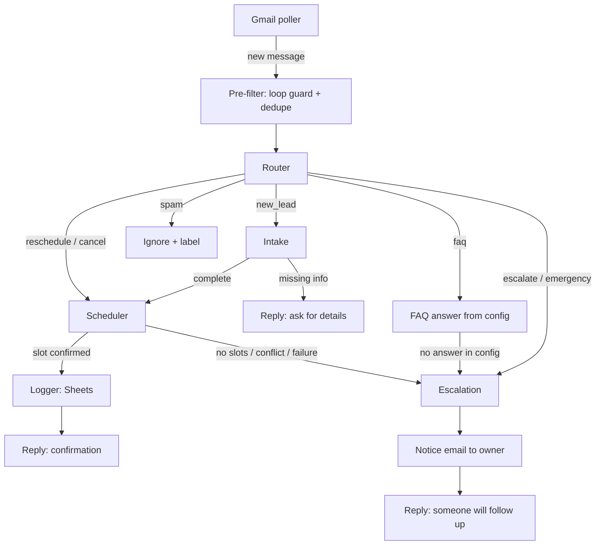

# Technical Specification
**Project:** HVAC Lead Intake & Booking Agent (Project 1)
**Version:** 0.1 (draft) | **Companion:** `BRD.md` (requirement IDs like BR-4 refer to it)

## 1. Overview
An email-driven multi-agent workflow built with **LangGraph**. A polling process reads new messages from a Gmail inbox, runs each through a graph (router, intake, scheduler, logger, escalation), sends an in-thread reply, and logs to Google Sheets. All business-specific behavior comes from a YAML config.

## 2. Technology stack
| Layer | Choice | Notes |
|---|---|---|
| Language | Python 3.11+ | Dev machine runs 3.13 |
| Orchestration | LangGraph | Graph, state, conditional routing, checkpointing |
| LLM wrappers | LangChain (`langchain-google-genai`, `langchain-groq`) | Model wrapper, structured output, tools only |
| Primary LLM | Gemini (free tier) | Model id from `GEMINI_NAME` (currently `gemini-3.8-flash`) |
| Backup LLM | Groq (free tier) | Model id from `GROQ_NAME` (currently `openai/gpt-oss-120b`) |
| Schemas | Pydantic | Structured output and validation |
| Email | Gmail API (OAuth) | Scope `gmail.modify` |
| CRM | Google Sheets API (OAuth) | Scope `spreadsheets` |
| Calendar | Local JSON file | Behind an interface; Google Calendar later |
| Config | YAML + `.env` | Behavior in YAML, secrets in `.env` |
| State persistence | `MemorySaver` | Durable store is Phase 2 |
| Tests | pytest | Unit tests plus scenario runner |

Pin all versions in `requirements.txt`.

## 3. Architecture


Components:
- **Adapters** (`adapters/`) isolate external systems behind small interfaces so nodes never call Google directly.
- **Agents** (`agents/`) are graph nodes. Each reads state, does one job, and returns only the fields it changes.
- **Core** (`core/`) holds the LLM factory, config loader, state schema, and metrics. No HVAC-specific code, so it can be reused.

## 4. Repository layout
```
core/       llm.py, config.py, state.py, metrics.py
agents/     router.py, intake.py, faq.py, scheduler.py, logger.py, escalation.py
adapters/   gmail.py, sheets.py, calendar_json.py
config/clients/hvac_demo.yaml
graph.py    builds and compiles the graph
main.py     polling loop
tests/      unit tests; tests/scenarios/ multi-turn scripts
data/       synthetic only (calendar.json, sample emails)
docs/       BRD.md, TECH_SPEC.md
```

## 5. State schema
```python
class State(TypedDict, total=False):
    thread_id: str              # Gmail thread id; also the checkpointer key
    message_id: str             # latest inbound message
    sender: str                 # customer email address
    messages: list[dict]        # {role, text, timestamp}
    category: str               # router output
    active_flow: str | None     # "intake" | "reschedule" | "cancel" | None
    lead: dict                  # name, phone, address, issue, urgency
    missing_fields: list[str]
    proposed_slots: list[str]   # ISO 8601 strings
    booking: dict | None        # {id, start, end, status}
    escalated: bool
    escalation_reason: str | None
    reply: str                  # text to send
    errors: list[str]
```
Rules: nodes return only changed keys; list fields that accumulate use reducers (for example `messages` appends).

## 6. Nodes
### 6.1 Pre-filter (not an LLM node)
Drops messages from no-reply addresses, with `Auto-Submitted` or `Precedence: bulk` headers, or from the agent's own address; skips message ids already labeled processed. (BR-9)

### 6.2 Router
- **Input:** latest message plus `active_flow`.
- **Output:** `category` in `new_lead | faq | reschedule | cancel | escalate | spam`.
- **Rule:** if `active_flow` is set, the router only changes category when the message clearly switches topic. Otherwise it continues the flow (prevents "tomorrow at 3" being read as a reschedule).
- **Implementation:** LLM with structured output (Pydantic `Literal`), `temperature=0`, plus a short reason field for debugging.
- **Hard rules before the LLM:** emergency keywords (gas, carbon monoxide, smoke, fire) force `escalate` with an emergency flag. (BR-8)

### 6.3 Intake
- **Job:** extract fields from the conversation into `lead`, compute `missing_fields`, and write one reply asking for what is missing (not a long questionnaire).
- **Required before booking:** name, contact (phone or email), service address or area, issue, urgency.
- **Output:** updated `lead`, `missing_fields`, `reply` (if incomplete). Urgency matches the config's urgency levels.
- **Validation in code:** service area is checked against config; out-of-area leads are told so and logged.

### 6.4 FAQ
- Answers only from config (`hours`, `services`, `service_area`, `faqs`, `pricing`). The prompt receives only these facts. If the answer is not present, set `escalated` with reason `unknown_faq`. (BR-5)

### 6.5 Scheduler
- **Tools:** `get_open_slots(start, end)`, `book_slot(slot, lead)`, `cancel_booking(id)`, `find_booking(contact)`.
- **Flow:** propose up to 3 open slots in business hours; on customer confirmation, call `book_slot`.
- **Guardrails:** `book_slot` re-checks availability immediately before writing and returns a conflict error if taken, after which the node re-offers slots. The LLM never decides availability. Dates are parsed to structured values by the LLM and validated in code (timezone from config, today's date injected into the prompt, hours checked). (BR-4)
- **Reschedule/cancel:** locate the booking via `find_booking` by sender/contact before acting.

### 6.6 Logger
Writes or updates a row in the Leads tab and, when booked, the Bookings tab. Idempotent by `thread_id` so reprocessing does not create duplicates. Urgent leads are flagged. (BR-6, BR-13)

### 6.7 Escalation
- Sends a notice email to `escalation.notify_email` with: reason, lead fields so far, last messages, thread link. Marks the thread so the agent does not keep replying after handoff.
- Replies to the customer that a person will follow up (for emergencies, also says to contact emergency services). (BR-7, BR-8)

## 7. Routing summary
| Router category | Next |
|---|---|
| `new_lead` | Intake, then Scheduler if complete, else reply asking for details |
| `faq` | FAQ node, escalate if unanswerable |
| `reschedule`, `cancel` | Scheduler (after booking lookup) |
| `escalate` | Escalation |
| `spam` | Label and ignore, no reply |

Conditional edges use a function that reads state and returns a key into a mapping, as in the lessons, but the real graph is written fresh.

## 8. LLM layer (`core/llm.py`)
- One factory returns the model for a given task. Nodes never construct models directly.
- Build the Gemini and Groq models, apply `with_structured_output(Schema)` to each, then combine: `primary.with_fallbacks([backup])`. Fallback triggers on rate-limit, quota, and server errors.
- `temperature=0` for routing and extraction.
- Each call records provider, tokens in/out, and latency via `core/metrics.py` (callback or wrapper).
- If both providers fail: send a minimal acknowledgment reply and escalate with reason `llm_unavailable`. (BR-11)

## 9. Adapters
```python
# adapters/gmail.py
def list_new_messages() -> list[InboundMessage]: ...
def send_reply(thread_id: str, to: str, body: str) -> None: ...
def send_notice(to: str, subject: str, body: str) -> None: ...
def mark_processed(message_id: str) -> None: ...      # applies a label

# adapters/sheets.py
def upsert_lead(thread_id: str, lead: dict, status: str) -> None: ...
def add_booking(thread_id: str, booking: dict) -> None: ...

# adapters/calendar_json.py   (same interface later for Google Calendar)
def get_open_slots(start: datetime, end: datetime) -> list[datetime]: ...
def book_slot(slot: datetime, lead: dict) -> Booking | None: ...   # None if taken
def cancel_booking(booking_id: str) -> bool: ...
def find_booking(contact: str) -> Booking | None: ...
```
Fakes of these interfaces power tests, so the graph can be run end to end with no network.

## 10. Configuration
`config/clients/hvac_demo.yaml` (illustrative):
```yaml
business:
  name: "Example HVAC Co"
  tone: "friendly, concise, professional"
  timezone: "America/New_York"
  hours:            # one key per day (mon..sun); days not listed are closed
    mon: ["08:00", "17:00"]
    tue: ["08:00", "17:00"]
    wed: ["08:00", "17:00"]
    thu: ["08:00", "17:00"]
    fri: ["08:00", "17:00"]
    sat: ["09:00", "13:00"]
  service_area: ["Metro City", "Northside"]
  services: ["AC repair", "Furnace repair", "Maintenance tune-up", "Installation quote"]
  appointment_minutes: 90
faqs:
  - q: "Do you offer emergency service?"
    a: "..."
pricing:
  diagnostic_fee: "..."
urgency_levels: ["emergency", "same_day", "this_week", "flexible"]
escalation:
  notify_email: "individual@example.com"
  emergency_keywords: ["gas", "carbon monoxide", "smoke", "fire"]
sheets:
  spreadsheet_id: "..."
```
All values synthetic. Secrets (API keys, OAuth files) are never in YAML.

## 11. Secrets
`.env`: `GEMINI_KEY`, `GEMINI_NAME` (model id), `GROQ_KEY`, `GROQ_NAME` (model id). Keys are passed to the model classes explicitly. OAuth: `credentials.json`, `token.json`. All gitignored. Never log values.

## 12. Data stores
**Calendar (`data/calendar.json`):** list of `{id, start, end, name, contact, status}`.
**Sheets, tab `Leads`:** `thread_id, created_at, name, contact, address, issue, urgency, category, status, escalated, reason`.
**Sheets, tab `Bookings`:** `booking_id, thread_id, start, end, name, contact, status`.

## 13. Error handling
| Failure | Behavior |
|---|---|
| Primary LLM error/rate limit | Fall back to Groq |
| Both LLMs fail | Acknowledge, escalate (`llm_unavailable`) |
| Structured output invalid | One retry, then escalate |
| Slot conflict | Re-offer slots |
| Sheets/Gmail API error | Retry with backoff; on repeated failure keep message unlabeled and log the error |
| Unknown exception in a node | Catch per message, log, escalate; one bad email must not stop the polling loop |

## 14. Observability and metrics
Per conversation: provider used, tokens in/out, latency per node, total latency, outcome. Cost per conversation = tokens multiplied by the paid-tier rate for the model used, reported separately because the actual cost is $0. Optional: LangSmith tracing.

## 15. Testing strategy
- **Unit tests:** one per node using fakes (no network); adapters tested with fixtures.
- **Scenarios (about 15):** scripted multi-turn conversations with expected final state or tool calls: new lead booked, FAQ answered, unknown FAQ escalates, double-booking attempt, reschedule, cancel, vague date, off-hours request, out-of-area, emergency, spam, auto-reply ignored, duplicate email, slot taken mid-conversation, LLM failure.
- **Runs:** each scenario 3 times at `temperature=0`; report pass rate and flaky cases.
- **Failure log:** every bug recorded in `BREAKLOG.md`.

## 16. Security and privacy
Synthetic data only. Dedicated demo Gmail account. Least-privilege OAuth scopes. Free-tier LLM terms may permit training on inputs, so no real data until terms are checked or a local/paid model is used. OAuth in Testing status expires after about 7 days.

## 17. Build plan
1. Foundation: requirements, layout, YAML, config loader
2. `core/llm.py` with failover (tested by forcing a failure)
3. `core/state.py`, `graph.py` skeleton with fake nodes
4. Router + tests, then intake, FAQ, scheduler (local calendar), logger, escalation
5. Gmail and Sheets adapters, wire `main.py`
6. Scenarios, metrics, README with diagram and failure notes, demo recording

## 18. Open questions
- Exact Gemini and Groq model names and current free-tier limits
- Polling interval for Gmail (for example 30–60 seconds)
- Whether the escalated thread should be labeled for human takeover
- Call date and hours available per day (affects what gets cut)
